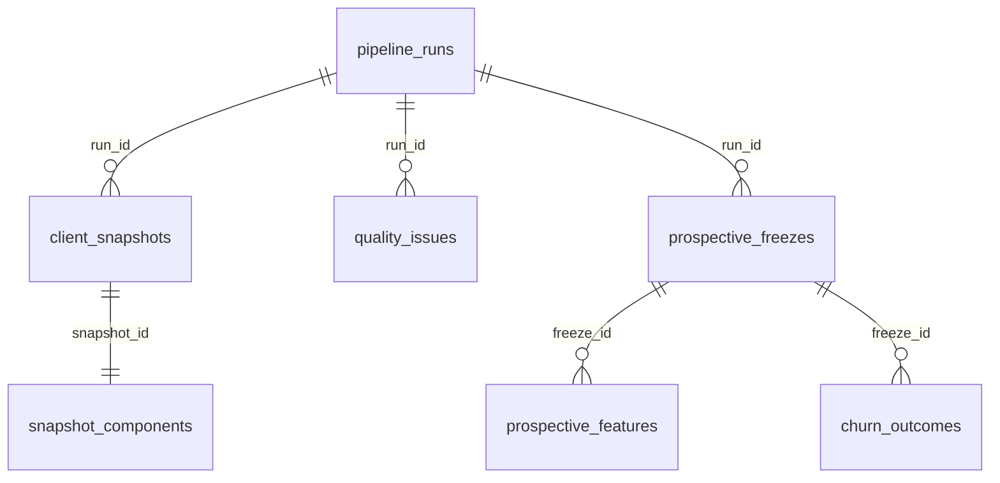

# Etapa 12 — Business Data + n8n

## Projetos Supabase

| Ambiente | Project ref | Uso |
|----------|-------------|-----|
| BASE QV | `lacinxsvjdwalkchxyeo` | **Somente leitura** (Health Score operacional) |
| Business Data | `rckpuebaiswrxzmywllv` | Escrita/leitura em `_dash_health_score` |

## Schema `_dash_health_score`

SQL versionado: `supabase/business-data/migrations/20261029180000_dash_health_score_etapa12_schema.sql`

Tabelas:

- `pipeline_runs` — execuções (idempotência por `idempotency_key`)
- `client_snapshots` — observação pseudonimizada por cliente/data/versão
- `snapshot_components` — componentes E/M/reuniões (1:1 com snapshot)
- `quality_issues` — diagnósticos de qualidade informacional
- `prospective_freezes` / `prospective_features` — congelamento mensal
- `churn_outcomes` — desfechos (preenchimento posterior, censura explícita)

RLS **ativado** em todas; **sem policies** para `anon`/`authenticated`. Acesso via **service role** no backend/n8n.

## Configuração (.env)

```env
# Business Data (NÃO usar URL da BASE QV)
BUSINESS_SUPABASE_URL=https://rckpuebaiswrxzmywllv.supabase.co
BUSINESS_SUPABASE_SERVICE_ROLE_KEY=<service_role do projeto Business Data>

# Pseudônimo estável entre máquinas (não commitar)
HS_MONITORING_PSEUDONYM_SECRET=<hex 64 chars>

# Endpoint seguro para n8n (POST)
MONITORING_PIPELINE_TOKEN=<token longo aleatório>
```

No dashboard Supabase → **API Settings**, incluir `_dash_health_score` em **Exposed schemas** (necessário para PostgREST com `Content-Profile`).

## Pipeline

O cálculo continua em `lib/monitoring/pipeline.mjs` (HS V1, 2.0A, diagnósticos). Após snapshot local:

1. `persistMonitoringToBusinessData()` grava no Business Data.
2. Idempotência: mesma `reference_date + population + version_fingerprint + filters_fingerprint` não duplica run.
3. Snapshots: `ON CONFLICT DO NOTHING` na chave composta (histórico preservado).

Comandos:

```bash
npm run monitoring:pipeline
npm run monitoring:persist-test   # pipeline + persistência (requer env)
```

## APIs

| Rota | Uso |
|------|-----|
| `GET /api/monitoring-history` | Runs, trend e freezes do Business Data |
| `GET /api/client-snapshot-history?clientId=` | Série HS/E/M pseudonimizada |
| `POST /api/monitoring/pipeline/run` | Trigger n8n/servidor (`Authorization: Bearer $MONITORING_PIPELINE_TOKEN`) |

## n8n

Workflow preparado (inativo): `research/n8n/health-analytics-pipeline.workflow.json`

- Schedule **desativado** até validação completa.
- n8n **não** acessa `localhost:3010`; usar URL pública do backend ou runner (GitHub Actions, VM, Cloud Run).
- Não recalcular HS no n8n — apenas orquestrar POST no endpoint.

Periodicidade proposta (quando ativar):

- Semanal: snapshot monitoramento.
- Mensal: freeze prospectivo.

## Validação (2026-10-29)

| Verificação | Resultado |
|-------------|-----------|
| Suite `npm test` | 91 testes OK (incl. `etapa12-business-data.test.mjs`) |
| Smoke SQL Business Data | 1 `pipeline_runs` + 1 `client_snapshots` (`2099-01-01`, idempotency `etapa12-smoke-test-key`) |
| Pipeline Node → BD | Requer `BUSINESS_SUPABASE_SERVICE_ROLE_KEY` + schema exposto no PostgREST |
| n8n | Workflow validado via MCP (`validate_workflow`); schedule **disabled** |

Remover linhas de smoke (`reference_date = '2099-01-01'`) quando houver runs reais do pipeline.

## Diagrama relacional (resumo)



## Critério de sucesso Etapa 12

- [ ] `BUSINESS_SUPABASE_SERVICE_ROLE_KEY` configurada
- [ ] Schema exposto na API do Business Data
- [ ] `npm run monitoring:persist-test` grava e relê snapshots
- [ ] Dashboard `/api/monitoring-history` responde 200
- [ ] n8n apontando para endpoint público (workflow importado, schedule off)
